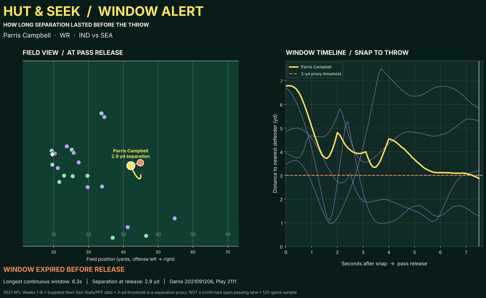
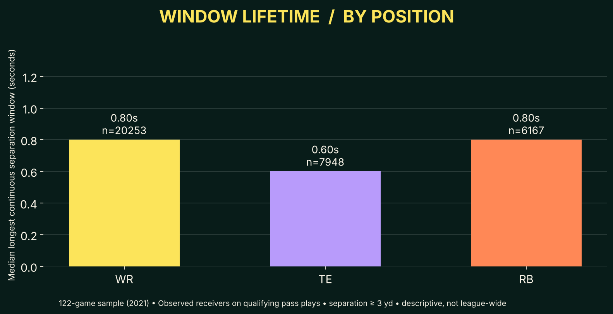

# 🏈 HUT & SEEK — Window Alert

**A receiver can be wide open and still never see the ball.** HUT & SEEK: Window Alert uses 2021 NFL Next Gen Stats tracking to time how long WRs, TEs and RBs stay open before the throw, giving broadcasters a replay-ready "the window was right there" graphic and giving coaches and scouts a way to spot receivers who win early but get left waiting.
Across 122 games (Weeks 1–8), 7,519 pass plays and 34,368 routes, **1 in 3 receivers (33.7%) got 3+ yards of space and then lost it before the ball came out**, like Blake Jarwin (DAL vs TB), who had 3+ yards of space for 3 straight seconds mid-route before the defender closed to 2.4 yards right at the throw, and he still caught it for 6 yards.
How it works: for every frame (10 per second) from snap to throw, we measure the distance from each route runner to the closest defender and count him as "open" at 3+ yards, starting 1 second after the snap so pre-snap cushion doesn't count.
The fine print: 3 yards is our working definition of "open," not an official one, and distance alone can't tell us what the quarterback saw or why he threw where he did.

### 👉 [Open the interactive visual (all 32 teams)](https://thurtzz.github.io/hut-and-seek-window-alert/) (backup link: [open via HTML preview](https://htmlpreview.github.io/?https://github.com/Thurtzz/hut-and-seek-window-alert/blob/main/index.html))

## 🎬 Explore the interactive site

- **Authentic tracking replays:** two featured plays, Blake Jarwin (DAL vs TB) and Parris Campbell (IND vs SEA), replay **actual frame-by-frame NFL tracking data** with synchronized separation charts and Play/Pause controls.
- **All-cases simulator:** every one of the 34,368 receiver-play observations can be opened in the Film Room as a playable separation-gap simulation (Play, Pause, Restart, progress) comparing peak separation, separation at release, and the 3-yard threshold. These simulations are **illustrative only**: they animate between each case's computed metrics and are **not** reconstructions of real player movement.
- **Complete case explorer:** filter all 122 games and 32 teams by team, game, receiver, and window status, open any case file, and step between observations.
- **Dynamic Huddles' Takeaway:** select any case in the Film Room and Huddles' Takeaway updates to that receiver: name, team, opponent and play ID; peak separation, separation at release, window length and closure timing; a short case-specific note written only from those recorded numbers; and the case's team closure rate compared with its position average and the league-wide 33.7%. A "Read Huddles' Takeaway for this case" button links the two. The takeaway reports the pass result as a play-level outcome (not proof the receiver was targeted) and makes no claims about quarterback decisions.
- **Team explorer:** compare window closures across all 32 teams and by position (WR, TE, RB).

All numbers in the site come from the same analysis as `output/window_metrics.csv`; only the two featured replays use real player coordinates.





[Per-receiver metrics](output/window_metrics.csv) · [Per-game summary](output/game_summary.csv) · [Featured play timeline](output/featured_window_timeline.csv) · [Interactive visual source](index.html) · [Colab notebook](HUT_AND_SEEK_ALL_GAMES_COLAB.ipynb)

## Run it

Easiest: open `HUT_AND_SEEK_ALL_GAMES_COLAB.ipynb` in Google Colab and choose **Runtime → Run all** (it downloads the data for you).

Or locally, with the organizers' dataset:

```bash
pip install -r requirements.txt
python window_alert.py --data /path/to/nfl-big-data-bowl-regional-event-data/data
```
